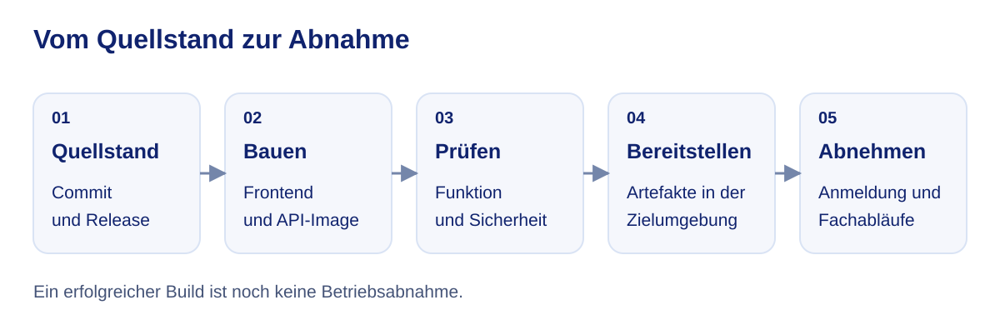

# Betrieb auf GKE

Stand: 13. November 2026
Status: Vorbereitung. Ein freigegebener Betrieb bei gematik ist noch nicht nachgewiesen.

Die Anwendung verbindet Versorgungs-Kompass und Hospitations-Kompass mit einer gemeinsamen Kontakt-, Organisations- und Profilgrundlage. [Architektur und Daten](../gematik/ARCHITEKTUR_UND_DATEN.md) beschreiben das Zusammenspiel von Oberfläche, Anmeldung, API und Datenbank.

Der Pilot ist von Beginn an für echte berufliche Kontakte und Hospitationsinhalte vorgesehen. Die Bewertung, betrieblichen Festlegungen und Zuständigkeiten werden im laufenden internen Compliance-Check geführt. Die folgenden Schritte beschreiben die technische Bereitstellung und ihre Nachweise.

## Bereitstellung

1. Den geprüften Quellstand nach [Übernahme und Updates](../gematik/RELEASE_UND_UPDATES.md) nach GitLab importieren und die Quellverantwortung bestätigen.
2. Gateway, Frontend-Hosting, GKE-Namespace, Registry, Secrets und PostgreSQL einrichten. Das [Datenbankverfahren](../../deploy/postgres/gematik-core/README.md) verwenden.
3. Einen freigegebenen signierten Quellstand verifizieren. Oberfläche und API daraus frisch bauen. Security-, Container-, Artefakt- und Helm-Gates nachweisen.
4. API über den nachgewiesenen Image-Digest und Oberfläche über das zugehörige Manifest im bestätigten Zielkontext aktivieren.
5. Die folgende technische Abnahme durchführen. Version, Commit, Digests, Schema, Konfiguration, Zielumgebung und Ergebnis gemeinsam protokollieren.

Das Target-Chart liefert die API. Datenbank, Frontend-Hosting und Datenübernahme benötigen eigene Einrichtung. Die [Referenzpipeline](../../deploy/jenkins/Jenkinsfile.gematik) ersetzt die institutionelle Plattformanbindung nicht.

## Erforderliche reale Zielprüfungen

| Bereich | Technische Abnahme |
| --- | --- |
| Betrieb | `/api/healthz`, `/api/readyz`, Rollout und interne Erreichbarkeit |
| Anmeldung | Oberfläche/Login, aktive Profilbindung, anonyme Ablehnung, manipulierte oder unbekannte Tokens |
| Isolation | API nur über das Gateway erreichbar, keine Übernahme unbestätigter Browser-Identitätsheader |
| Rollen | Benannte Lese- und Schreibrolle mit erwarteten Rechten |
| Fachablauf | Synthetischer Kontakt- und Hospitationsablauf, Export, Bereinigung und DB-Stichprobe |
| Wiederherstellung | Erfolgreiche Sicherung und praktisch geprüfter isolierter Restore |

Diese Prüfungen verwenden synthetische Daten und sind vom Pilotbetrieb mit Echtdaten zu unterscheiden. Ein technischer Jenkins-Smoke oder `validate_only` bestätigt keine vollständige Betriebsabnahme. Die kontrollierte Übernahme der für den Pilot vorgesehenen Echtdaten richtet sich nach der intern dokumentierten Entscheidung. Umfang, Mengen und Fingerprint werden getrennt bestätigt.

## Wartung und Störung

Mindestens Readiness, Pod-Neustarts, Datenbankverbindungen und erfolgreiche Sicherungen überwachen. Konkrete Intervalle, Alarmwege, Wiederherstellung und Rotation werden in der Betriebsdokumentation festgehalten. Logs und technische Nachweise enthalten keine Fachdaten, Tokens oder OIDC-Subjects.

Updates durchlaufen Review, Release und dieselben Target-Gates. Schemaänderungen werden kontrolliert ausgeführt. Die API migriert beim Start nicht automatisch. Vor jedem Update Kompatibilität und Rückweg prüfen.

Bei einer Störung Rollout, Pods, Gateway und Datenbankverbindung prüfen. Bei falschen Rechten oder vermuteter Datenbeschädigung den Zugang kontrolliert sperren. Der Software-Rückweg aktiviert die letzte abgenommene Kombination aus API-Digest, Oberfläche und Konfiguration. Helm stellt Oberfläche und Datenbank nicht automatisch zurück. Ein alter Dump ist nach neuen Schreibvorgängen kein verlustfreier Rückweg.

[QA](../gematik/ENTWICKLUNG_UND_QA.md) und [Security](../../SECURITY.md) ergänzen die technischen Prüfungen. Bewertung und Entscheidungen zum Einsatz bleiben im [laufenden internen Compliance-Check](../gematik/DATENSCHUTZ_UND_COMPLIANCE.md).
