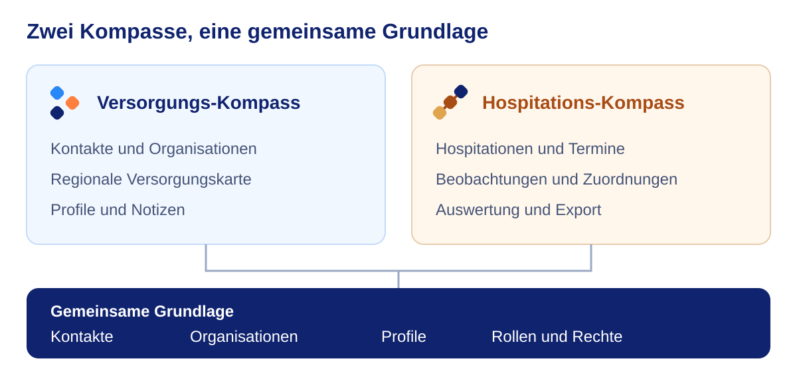

# Anwendung

Stand: 13. November 2026

Die Anwendung unterstützt die interne Arbeit mit Versorgungseinrichtungen und Hospitationen. Sie verbindet den Versorgungs-Kompass und den Hospitations-Kompass auf einer gemeinsamen Datengrundlage.

## Gemeinsame Grundlage

Kontakte und Organisationen halten berufliche Angaben und Beziehungen fest. Profile ordnen die Nutzenden zu. Rechte bestimmen, welche Daten und Aktionen zugänglich sind. Änderungen bleiben nachvollziehbar.

Die institutionelle Anmeldung wird einem freigegebenen Profil zugeordnet. Die API prüft Rolle und Zugriff bei jeder Anfrage. Eine bestätigte Identität allein erteilt keine fachliche Berechtigung.

## Die beiden Kompasse

| Bereich | Aufgabe |
| --- | --- |
| Versorgungs-Kompass | Berufliche Kontakte und Organisationen pflegen, suchen und regional auf der Karte einordnen |
| Hospitations-Kompass | Termine vorbereiten, Hospitationen dokumentieren, Beobachtungen im Framework ordnen und Ergebnisse auswerten oder exportieren |

Vor einer Hospitation Organisation, Ansprechperson, Termin und Kontext prüfen. Beobachtungen sachlich dokumentieren und mit ihrer Quelle verbinden. Erinnerung, beobachteter Sachverhalt und spätere Interpretation bleiben unterscheidbar. Die Auswertung kann daraus Muster und Hypothesen bilden.

## Vorgesehene Nutzung

Erfasst werden berufliche Kontakte und sachliche Hospitationsinhalte. Identifizierende Patienten- und Gesundheitsdaten sowie personenbezogene Fallbeschreibungen sind ausgeschlossen. Freie Notizen und Exporte benötigen dieselbe Sorgfalt wie strukturierte Felder.

Geplant ist ein interner Pilot mit ungefähr fünf benannten Kolleginnen und Kollegen über etwa sechs Monate. Nutzerkreis, Zeitraum und Freigaben sind noch zu bestätigen. Die [Compliance-Ausfüllhilfe](DATENSCHUTZ_UND_COMPLIANCE.md) und [Betriebsanleitung](../betrieb-und-deployment/BETRIEB_GEMATIK.md) benennen die offenen Entscheidungen.
