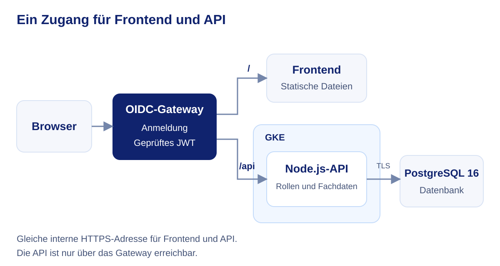

# Architektur und Daten

Stand: 13. November 2026

Die Anwendung besteht aus einer Oberfläche im Browser, einer Node.js-API und einer PostgreSQL-16-Datenbank. Die Oberfläche wird als statische Dateien bereitgestellt. Die API verarbeitet Anfragen, prüft Rechte und greift auf die Datenbank zu. GKE betreibt die API.

## Anmeldung und Datenzugriff

| Bestandteil | Vertrag |
| --- | --- |
| Interne Adresse | Oberfläche und `/api` liegen unter derselben HTTPS-Adresse hinter dem institutionellen Gateway |
| OIDC-Anmeldung | Das Gateway entfernt Browser-Identitätsheader und übergibt ein geprüftes signiertes JWT als Bearer-Token an die API |
| Rechte | Die API prüft Token, aktives Profil, Rolle und erlaubte Aktion serverseitig |
| Fachdaten | Der Browser lädt sie ausschließlich über die geschützte API |
| Datenbank | Eingeschränkte Laufzeitrolle, verschlüsselte Verbindung und kontrollierte Schemaänderungen |
| Buildnachweis | Oberfläche und API stammen aus demselben Quellstand und erhalten eigene Inhaltsdigests |

Die API darf nur über das Gateway erreichbar sein. Der Browser verwaltet selbst keine Anmeldetokens. Der Plattformanschluss muss den beschriebenen Bearer-JWT-Vertrag erfüllen.

## Datenbestand

Zum Datenmodell gehören Organisationen, berufliche Kontakte, Profile und Rollen sowie Hospitationstermine, Framework-Zuordnungen, Beobachtungen und Auswertungsbezüge. Echte Fachdaten bleiben außerhalb von Git, Images, Buildmanifesten, Screenshots und technischen Prüfberichten.

Die erste Abnahme verwendet das geprüfte Schema und synthetische Daten. Eine spätere Datenübernahme benötigt bestätigte Datenklassen und prüft Abhängigkeiten, Mengen und Fingerprint. Quellbereitstellung und Datenübernahme sind getrennte Vorgänge.

Kartenanbieter, Zielhosts, Lizenz, Schlüssel und übertragener Datenumfang sind vor Nutzung zu bestätigen. Neue Bild- und Datei-Uploads sind deaktiviert. Für vorhandene Dateien sind Speicher, Plattformwerte und Freigabe gesondert festzulegen. Der vorhandene Speicheradapter verwendet die GCS-API.

## Technische Quellen

- [API-Routen und Tabellenumfang](../../api/gematik-core-policy.mjs)
- [Datenbankschema und Einrichtung](../../deploy/postgres/gematik-core/README.md)
- [Laufzeitkonfiguration](../../config/target/deployment.json)
- [Kubernetes-Konfiguration](../../deploy/helm/versorgungs-kompass/values-target-gematik.yaml)
- [Referenzpipeline](../../deploy/jenkins/Jenkinsfile.gematik)

Konkrete Zielwerte, Zugangsdaten und Abnahmeprotokolle werden geschützt geführt. [Betrieb](../betrieb-und-deployment/BETRIEB_GEMATIK.md) und [Security](../../SECURITY.md) beschreiben die Voraussetzungen.
