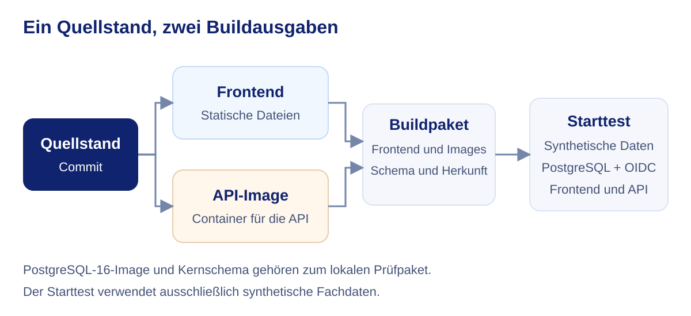

# Build und Qualitätssicherung

Stand: 13. November 2026

Ein Build erzeugt aus den Quellen die auslieferbaren Anwendungsdateien. Die Oberfläche und die API werden getrennt gebaut und gemeinsam geprüft. Die [Arbeitsregeln](../../AGENTS.md) gelten für Änderungen auf Branches und deren Integration per Pull Request.



## Lokaler Gesamtprobelauf

Node.js 22, npm, Docker und OpenSSL bereitstellen. Chromium einmalig installieren und das Paket bauen:

```bash
npm ci
npx --no-install playwright install chromium
npm run package:proof
```

Die Ausgabe nennt das Paket unter `dist/local-proof/`. Diesen Dateipfad im folgenden Aufruf einsetzen:

```bash
npm run test:package -- "dist/local-proof/PAKETDATEI.tar.gz"
```

Das Paket enthält Oberfläche, API-Image, PostgreSQL-16-Image, Schema, Prüfsummen und Herkunft. Der Test entpackt es separat und startet eine kurzlebige synthetische OIDC-Prüfanmeldung, die echte API und Datenbank sowie den Browser. Ein ungecommitteter Quellstand wird ausdrücklich gekennzeichnet.

Der Probelauf zeigt den lokalen Start der Anwendung. Institutionelle Anmeldung, Plattformanbindung und Betriebsfreigabe benötigen die gesonderte Zielabnahme.

Auf GitHub lässt sich derselbe Ablauf unter **Actions → Build-Probelauf → Run workflow** starten. Nach erfolgreicher Prüfung stehen Paket und Prüfnachweis dort drei Tage zum Herunterladen bereit. Die [Workflow-Datei](../../.github/workflows/build-proof.yml) beschreibt den Ablauf.

Für einzelne Buildschritte stehen `build:target` und `build:api:target` bereit. Die erste Ausgabe ist das statische Frontend, die zweite der gebündelte API-Code. [api/Dockerfile](../../api/Dockerfile) beschreibt das API-Image.

## Prüfungen

| Zweck | Befehl |
| --- | --- |
| Kleine lokale Dokumentationsprüfung | `npm run qa:small` und `npm run check:docs-language` |
| API-, Container- und Artefaktverträge | `npm run check:target-release` |
| Browserprüfung | `npm run test:gematik-ui` |
| Vollprüfung vor PR und Integration | `npm run qa:full` |

Die Tests prüfen Datenzugriff, serverseitige Rollen, Funktionsumfang und Anwendungsartefakte. Fachabläufe werden mit synthetischen Daten geprüft. Sichtbare Änderungen erhalten Desktop- und relevante mobile Screenshot-Vorschauen. Eigene Browser und Testserver danach schließen. Ausgaben in `dist/` und Testberichte bleiben unversioniert.

Nach bewussten Quelländerungen `npm run manifest:import` und `npm run verify:import` ausführen. Dateiinventar, Prüfsummen und fachlichen Diff zusammen prüfen. Das Manifest ist keine Release-Freigabe.

## Zusätzlich vor dem Zielbetrieb

Die reale Abnahme umfasst Oberfläche und Login, anonyme Ablehnung, manipulierte oder unbekannte Tokens, Netzisolation, Lese- und Schreibrolle, synthetisches CRUD mit Bereinigung, DB-Stichprobe und isolierten Restore. Ein technischer Jenkins-Smoke allein genügt nicht.

[SECURITY.md](../../SECURITY.md) ergänzt die Scanner-, SBOM- und Attestationsgates. Fehlende zentrale Nachweise sperren das Deployment. `not-run` ist nur für lokale Vorprüfungen zulässig. Eine erfolgreiche Vollprüfung oder Integration erstellt weder einen Release-Tag noch eine Betriebsfreigabe.
